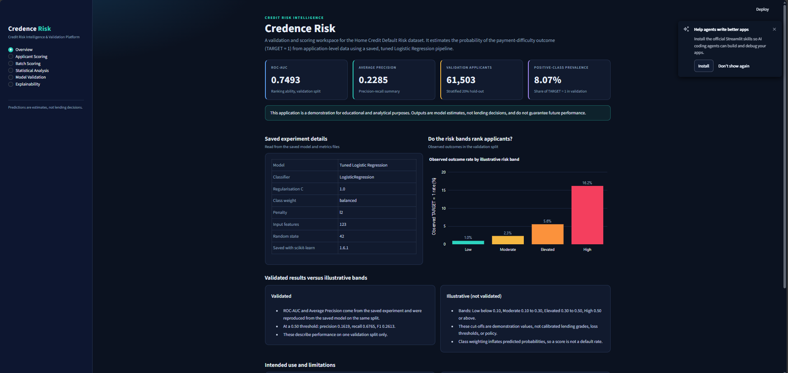
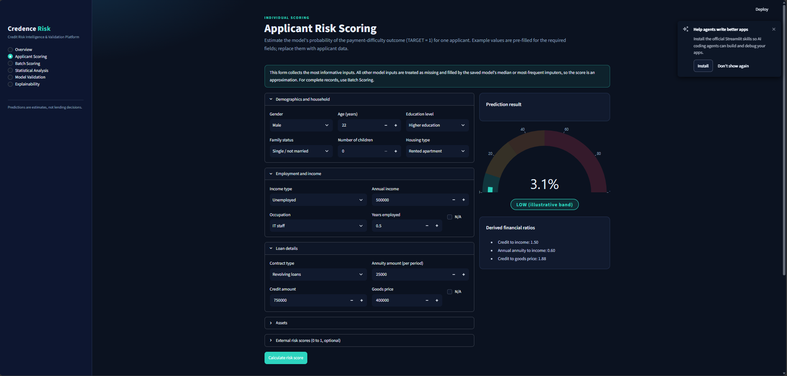
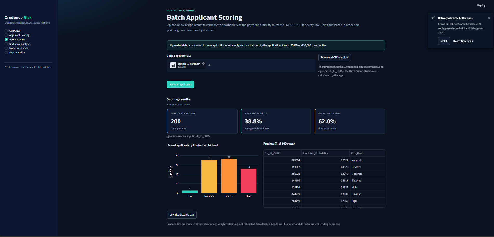
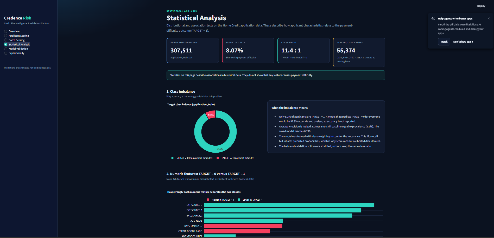
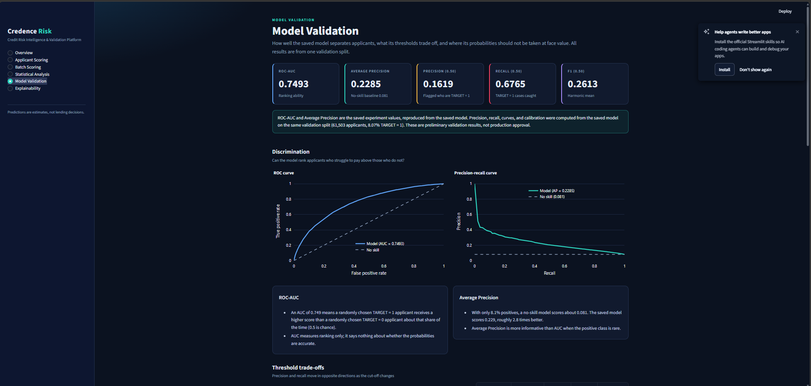
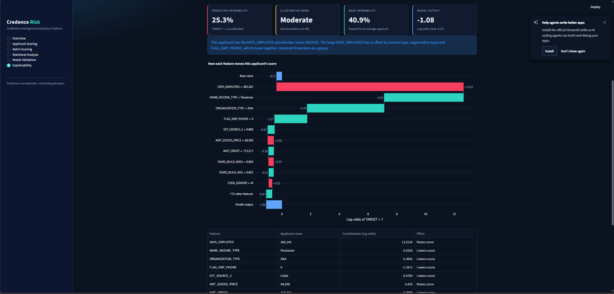

# Credence Risk: Credit Risk Intelligence & Validation Platform

A Streamlit application for scoring, validating and explaining a credit-risk model trained on the Kaggle Home Credit Default Risk dataset. The model estimates the probability of the dataset's payment-difficulty outcome (`TARGET = 1`) from application-level data.

This is a portfolio demonstration. It does not approve, reject or recommend lending decisions, and it has not been assessed for fairness, regulatory compliance or production readiness.

## Screenshots

| Overview | Applicant Scoring |
|---|---|
|  |  |

| Batch Scoring | Statistical Analysis |
|---|---|
|  |  |

| Model Validation | Explainability |
|---|---|
|  |  |

## Problem statement

Lenders need to rank applicants by the likelihood of repayment difficulty and to understand how reliable that ranking is. The positive class is rare (about 8% of applicants), so the project emphasises ranking quality (ROC-AUC, Average Precision), threshold trade-offs, calibration limits and explainability, not accuracy.

## Dataset

- Source: Kaggle, [Home Credit Default Risk](https://www.kaggle.com/c/home-credit-default-risk).
- Used by the app: `application_train.csv` (307,511 applicants, 8.07% `TARGET = 1`).
- The other Home Credit tables (bureau, previous applications, installments and so on) are not used. The model was trained on application-level features only.
- The dataset is not included in this repository. Download it from Kaggle and place the files in `datasets/`.

## Machine-learning workflow (completed in the notebook)

1. Explored shape, types, target balance, missing values and outliers (outliers were investigated, not deleted).
2. Engineered three ratio features (below).
3. Split the data 80/20, stratified, `random_state=42`.
4. Built a scikit-learn preprocessing pipeline: median imputation and standard scaling for numeric features, most-frequent imputation and one-hot encoding for categorical features.
5. Trained Logistic Regression and Random Forest (both class-weighted), then tuned Logistic Regression with cross-validation using Average Precision as the selection metric.
6. Saved the tuned pipeline (preprocessing and classifier) as a single artifact.

The notebook is `Credit Risk Intelligence and  Validation Platform.ipynb`. The app does not retrain anything.

### Feature engineering

| Feature | Formula |
|---|---|
| `CREDIT_INCOME_RATIO` | `AMT_CREDIT / AMT_INCOME_TOTAL` |
| `ANNUITY_INCOME_RATIO` | `(AMT_ANNUITY * 12) / AMT_INCOME_TOTAL` |
| `CREDIT_GOODS_RATIO` | `AMT_CREDIT / AMT_GOODS_PRICE` |

A zero denominator becomes a missing value, which the saved median imputer then fills. The same formulas are used in `app/services/risk_scoring.py`.

## Models and validation results

All values are from a single stratified validation split of 61,503 applicants (8.07% `TARGET = 1`).

| Model | ROC-AUC | Average Precision |
|---|---:|---:|
| Logistic Regression (baseline) | 0.7493 | 0.2285 |
| Random Forest | 0.7379 | 0.2165 |
| Tuned Logistic Regression (saved model, C = 1.0) | 0.7493 | 0.2285 |

The Random Forest and baseline figures come from the notebook. The saved model's ROC-AUC and Average Precision were reproduced from the saved artifact by `scripts/build_validation_artifacts.py`, which refuses to write any report if they do not match `models/model_metrics.json`.

At a 0.50 threshold the saved model has precision 0.1619, recall 0.6765 and F1 0.2613.

Observed `TARGET = 1` rates by illustrative band in validation: Low 1.0%, Moderate 2.3%, Elevated 5.6%, High 16.2%.

These are preliminary results from one split, with no confidence intervals and no out-of-time validation. They are not proof of production suitability.

## Application pages

| Page | Purpose |
|---|---|
| Overview | Saved experiment details, verified metrics, intended use and limitations |
| Applicant Scoring | Score one applicant from a form of the most informative inputs |
| Batch Scoring | Upload a CSV, score every row, download the results |
| Statistical Analysis | Class imbalance, Mann-Whitney U with effect sizes, Spearman correlation, chi-square with Cramer's V, missing values |
| Model Validation | ROC and precision-recall curves, threshold trade-offs, calibration, risk bands against observed outcomes |
| Explainability | Global and individual SHAP explanations |

### Risk bands

| Band | Predicted probability |
|---|---|
| Low | below 0.10 |
| Moderate | 0.10 to below 0.30 |
| Elevated | 0.30 to below 0.50 |
| High | 0.50 or above |

These are demonstration bands, configurable through `RISK_BAND_THRESHOLDS`. They are not calibrated lending grades, validated loss thresholds or approved policy. The model was trained with class weighting, so predicted probabilities are inflated (average prediction about 39% against an 8% base rate). Use scores for ranking, not as default rates.

## Explainability

The saved model is a Logistic Regression, so SHAP values have an exact closed form: `coefficient x (applicant value - training mean)`, in log-odds. The app uses that formula at runtime and does not need the `shap` package. `scripts/build_explainability_artifacts.py` cross-checks it against `shap.LinearExplainer` and records the result, which the Explainability page displays. Contributions describe associations learned by the model, not causal effects.

Known data issue: `DAYS_EMPLOYED = 365243` is a placeholder the Home Credit data uses for applicants who are not currently employed (about 18% of applicants). The notebook left it as a real number, so the model treats it as an extreme employment length. It therefore ranks first in the SHAP chart, with its effect largely offset by income type, organisation type and `FLAG_EMP_PHONE`. The app flags this where it matters. It was not fixed because the model must not be retrained.

## Project structure

```text
Credence Risk/
├── app/
│   ├── main.py                  Streamlit entry point
│   ├── config.py                Settings from environment variables
│   ├── theme.py                 Visual theme and Plotly styling
│   ├── components/              Metric cards and chart builders
│   ├── services/                model_loader, risk_scoring, explain, cache
│   └── views/                   One module per page
├── models/                      Saved model, metrics, feature schema
├── reports/                     Generated validation, statistics and SHAP summaries
├── scripts/                     Report builders and sample-data helper
├── tests/                       pytest suite (synthetic fixtures)
├── docs/screenshots/            README screenshots
├── .streamlit/config.toml       Theme and upload limit
├── datasets/                    Home Credit CSV files (not committed)
├── samples/                     Generated sample CSV (not committed)
├── requirements.txt
├── .env.example
└── README.md
```

## Setup on Windows (PowerShell)

The saved model was created with scikit-learn 1.6.1, which supports Python 3.13 or earlier. Use the same version, because other versions may fail to load the model or give different results.

Run all commands from the project root.

```powershell
# 1. Create and activate a virtual environment (Python 3.13)
py -3.13 -m venv .venv
.\.venv\Scripts\Activate.ps1
```

If PowerShell blocks the activation script, run `Set-ExecutionPolicy -Scope CurrentUser -ExecutionPolicy RemoteSigned` once and try again. The prompt should start with `(.venv)`.

```powershell
# 2. Install dependencies
python -m pip install --upgrade pip
python -m pip install -r requirements.txt

# 3. Create local configuration
Copy-Item .env.example .env

# 4. Verify the model artifacts exist
dir models
```

`models` must contain `credence_risk_model.joblib`, `model_metrics.json` and `feature_columns.json`. `feature_columns.json` can be regenerated from the model:

```powershell
python -c "import joblib,json; m=joblib.load('models/credence_risk_model.joblib'); json.dump(list(m.feature_names_in_), open('models/feature_columns.json','w'), indent=2)"
```

Only load model files you created yourself. Joblib files can execute code when loaded.

### VS Code interpreter

VS Code does not automatically use the same Python as your notebook. Press `Ctrl+Shift+P`, choose **Python: Select Interpreter**, and select `.venv\Scripts\python.exe` from this project. A notebook run with a different Python and scikit-learn version may fail to load the model.

### Generate the reports (once)

The Statistical Analysis, Model Validation and Explainability pages read pre-computed reports from `reports/`. This needs `datasets/application_train.csv`.

```powershell
python scripts\build_validation_artifacts.py
python scripts\build_explainability_artifacts.py
```

The first script recomputes the saved ROC-AUC and Average Precision and stops without writing anything if they do not match `models/model_metrics.json`.

## Run the app

```powershell
python -m streamlit run app/main.py
```

The app opens at `http://localhost:8501`.

## Run the tests

```powershell
python -m pytest -v
```

The suite uses a small synthetic model and does not load the full dataset. Two tests also check the real saved model and skip themselves if the model or dataset is missing.

## Configuration

Settings are read from `.env` (copy of `.env.example`). Only variables the app uses are listed there.

| Variable | Default | Purpose |
|---|---|---|
| `APP_TITLE` | `Credence Risk` | Browser tab title |
| `MODELS_DIR` | `models` | Location of model artifacts |
| `REPORTS_DIR` | `reports` | Location of generated reports |
| `RISK_BAND_THRESHOLDS` | `0.10,0.30,0.50` | Illustrative band cut-offs |
| `MAX_UPLOAD_MB` | `20` | Batch upload size limit |
| `MAX_UPLOAD_ROWS` | `50000` | Batch upload row limit |

If you raise the upload limit, also raise `maxUploadSize` in `.streamlit/config.toml`. The app makes no external API calls and stores no uploaded data.

## Preparing input CSV files for Batch Scoring

1. Open the Batch Scoring page and select **Download CSV template**. It lists the 120 required input columns plus an optional `SK_ID_CURR`.
2. Fill one row per applicant. Column names must match exactly. Order does not matter.
3. Leave unknown values blank. The saved model fills them with training medians or most frequent values.
4. Do not include the three ratio columns. The app calculates them.
5. `SK_ID_CURR` and `TARGET`, if present, are never used as model inputs. Extra columns are kept in the download but not used.
6. Save as CSV (UTF-8). The file must be under the size and row limits.

Non-numeric values in numeric columns are treated as missing, and categories the model has not seen are ignored by the encoder. Both are reported as warnings.

To try it with real rows, `python scripts\make_sample_csv.py` creates `samples/sample_applicants.csv` (200 applicants, no `TARGET`).

## Example workflow

1. Run the app and open **Batch Scoring**.
2. Upload `samples/sample_applicants.csv` and select **Score all applicants**.
3. Review the band distribution and preview, then download `scored_applicants.csv`. It contains your original columns plus `Predicted_Probability` and `Risk_Band`.
4. Open **Explainability**, upload the same file, and choose a row to see which features raised or lowered that applicant's score.
5. Read **Model Validation** to see how far to trust the scores.

## Limitations and responsible use

- Application-level features only. The Home Credit historical tables are not used.
- Probabilities are not calibrated. Class weighting inflates them, so they are not default rates.
- Risk bands are illustrative and have no policy standing.
- Validation is a single 80/20 split, with no confidence intervals, cross-validated spread or out-of-time test.
- Single-applicant scoring uses a form of the most informative inputs, and every other input is imputed. Batch scoring with complete records is more faithful to the model.
- The `DAYS_EMPLOYED` placeholder issue described above affects the model and its explanations.
- Statistical and SHAP results describe associations in historical data, not causes.
- No fairness, bias, stability, privacy or regulatory assessment has been performed. Do not use this application to make or support real lending decisions.
- The data is a public, anonymised competition dataset, so results do not transfer to any real lending portfolio.
